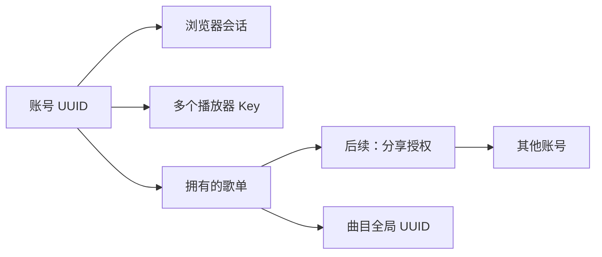

# 账号登录与多账户、歌单分享方案（第一版）

日期：2026-10-22。状态：方案已确认，第一期已在 0.9.0 / schema 4 实施；第二期多账户管理和第三期分享尚未开放。

多用户阶段的最新确认规则与逐项进度以 [多用户版本开发方案与进度](多用户版本开发方案与进度.md) 为准：本期开放全局曲库、成员上传、私人歌单、账户停用/重新启用及管理员资源接管，暂不做歌单分享。下文保留第一版方案和阶段实施记录，旧的成员全库访问限制不再作为第二期实施依据。

## 1. 推荐方向与本期范围

采用本地账号密码、服务端会话和账号所属的播放器 API Key。继续使用 Go、SQLite 及当前管理页面，不增加独立认证服务。

第一期实现管理员账号初始化、登录/退出、会话保持、修改/重置密码，以及通过登录后的管理页创建和管理播放器 Key。从第一期建立可容纳多个账号的数据模型，并为歌单、Key、暂存上传记录账号归属。

第二期增加管理员创建/停用成员账号、账号管理页面、成员的私人歌单和个人设置。第三期开放站内歌单分享。公开分享链接放在后续独立阶段。

第一期不开放注册、邮箱验证、邮件找回、第三方登录或双因素认证；普通用户和分享页面不在本期上线。表结构和授权入口应支持扩展，但不提前实现无人使用的分享表和公开链接接口。

## 2. 账号、会话、Key 和歌单的关系



- 账号是身份主体，具有独立 UUID、角色和启用状态。修改用户名不改变账号 ID。
- 会话用于浏览器登录，保存账号关联、过期时间和撤销状态。
- 每个播放器 Key 归属一个账号，可独立限制歌单、scopes、并发、过期时间和撤销状态。
- 每个用户歌单具有一个所有者；分享通过附加授权关联账号，不复制歌单或曲目。
- 曲目继续是服务器共享资源，以原有永久 UUID 标识。首期不建立每个账号一套音频库。

现有 Key 自带角色的模型调整为账号持有角色；播放器 Key 只提供读取和媒体访问能力。管理员账号签发的播放器 Key 也必须经过歌单和 scope 限制，不继承管理员全库权限。脚本管理接口的长期凭证若以后确有需求，再独立设计。

## 3. 登录和日常使用

### 初始化

首次使用直接运行 `server/start.bat`，交互输入并确认密码；也可在 `server` 目录提前运行本机命令：

```bat
build\musicserver.exe admin init
```

命令默认使用 `build/data/library-v4.sqlite` 和用户名 `admin`，需要覆盖时再显式传参。密码采用隐藏输入，不通过命令行参数传入，也不写入批处理脚本或日志。初始化在事务中检查是否已有管理员，已有管理员时拒绝重复初始化。不设置默认密码，不允许公网请求创建首个管理员。

`start.bat` 固定启动 `build/musicserver.exe`，首次在真实终端引导初始化；非交互环境未初始化时退出并提示本机初始化。初始化和密码重置命令也可在停服状态独立运行。整个 `build/` 被 Git 忽略，源码、脚本和文档由 Git 管理。

### 登录

管理页未登录时显示用户名、密码和登录按钮，成功后进入现有管理页。刷新页面通过会话恢复登录状态，退出登录立即撤销当前会话。浏览器不再要求输入管理员 API Key。

建议初始会话策略：空闲 2 小时过期，绝对有效期 7 天；后台自动轮询不延长空闲时间。前端在可见页面的用户交互后限频发送活动请求，服务端只更新最后活动时间，绝对有效期不延长。刷新页面保留登录，服务器每次启动撤销全部旧会话，因此服务重启后需要重新登录；播放器 Key 不受重启影响。首期不设置额外的“永久记住登录”。这些时间是产品默认值，可在后续调整。

### 凭证存储与请求保护

- 密码使用 Argon2id 和独立随机盐，保存算法与参数；不复用当前 API Key 的 SHA-256 处理方式。参数按服务器实测确定，至少满足 OWASP 当前基线：19 MiB、2 次迭代、并行度 1。[密码存储参考](https://cheatsheetseries.owasp.org/cheatsheets/Password_Storage_Cheat_Sheet.html)
- 会话使用至少 256 位随机令牌，数据库保存令牌哈希；浏览器使用 `HttpOnly`、`SameSite=Strict`、`Path=/` 的 Cookie，HTTPS 部署启用 `Secure`。会话、密码均不放入 localStorage。[会话管理参考](https://cheatsheetseries.owasp.org/cheatsheets/Session_Management_Cheat_Sheet.html)
- 浏览器写请求验证 CSRF 令牌和来源，登录接口也验证来源；会话 Cookie 不作为跨站调用接口的凭证。
- 非回环部署要求明确配置 HTTPS 外部地址及可信反向代理；不能无条件相信客户端传入的 `X-Forwarded-Proto`。仅明确的本机 HTTP 开发配置允许不设置 Secure。
- 登录失败统一提示“用户名或密码错误”。按账号规范化名称和客户端 IP 限速，并限制同时执行的密码哈希数量；建议连续 5 次失败后进行短时退避，返回 429，不永久锁死账号。可信代理外不采用任意转发头作为 IP。

### 改密与找回

登录后的改密需要验证旧密码，成功后撤销该账号全部浏览器会话并要求重新登录。改密不默认撤销播放器 Key，页面另提供撤销全部 Key 的操作。普通密码重置同样不隐式破坏所有播放器配置。

忘记密码通过停服后的本机命令交互重置：

```bat
build\musicserver.exe admin reset-password
```

重置撤销该账号所有会话；如果怀疑凭证泄露，可同时选择撤销该账号全部 Key。账号停用撤销浏览器会话，Key 因账户状态暂不可用但不撤销；重新启用后，未被单独撤销、未过期且符合当前授权的同一 Key 恢复可用，统计保留。

## 4. 为多账户确定权限边界

| 操作 | 管理员账号 | 成员账号（第二期） | 播放器 Key |
| --- | --- | --- | --- |
| 服务器设置、扫描、备份、审计、账号管理 | 允许 | 不允许 | 不允许 |
| 全局曲目元数据编辑、上传、软移除、恢复 | 允许 | 首版不允许 | 不允许 |
| 创建和编辑自己的歌单、排序、成员备注 | 允许 | 允许 | 不允许 |
| 访问其他账号的歌单 | 允许，管理访问记审计 | 需要分享授权 | 受所属账号与 Key 双重限制 |
| 管理播放器 Key | 可管理全部 | 仅自己的 Key | 不允许 |

普通成员默认只读取自己歌单和获分享歌单所需的曲目与封面。系统 `library` 歌单代表全库，默认仅管理员可见；管理员可明确将其授权给某个播放器 Key，创建普通账号不会自动得到全库访问。

未来成员可从明确向其开放的曲目集合创建歌单；不提供一个默认列出所有私有曲目的选择器。是否增加“所有成员均可浏览的公共音乐目录”作为后续产品选项，默认关闭。

播放器 Key 的有效权限为：

```text
账号当前可访问资源 ∩ Key 指定歌单 ∩ Key scopes
```

账号降权、停用、失去分享权限后，不能继续依靠旧 Key 读取。Key 的持有者不需要知道账号密码；Key 不保存账号权限的永久副本。登录会话和 Key 都转换成统一的请求身份，但每次请求仍检查当前资源授权。[授权参考](https://cheatsheetseries.owasp.org/cheatsheets/Authorization_Cheat_Sheet.html)

请求携带显式 API Key 时仅使用该 Key；Key 无效时直接失败，不回退到浏览器 Cookie，也不合并两套权限。没有显式 Key 时才检查会话。浏览器管理接口要求账号会话，播放器 Key 只能调用允许的读取接口。

歌单编辑、成员备注和个人排序不改写全局曲目；所有成员看到的全局曲目信息由管理员维护。曲目路径、暂存列表、封面、直接媒体下载和同步都执行资源检查，避免只保护歌单列表。普通账号响应不暴露无权访问的曲目 ID、备注、文件路径或暂存记录。

## 5. 后续歌单分享

先做已登录账号之间的分享，由所有者选择目标账号和权限。普通用户不能枚举全部账号；输入完整用户名匹配目标，未来可增加邀请码。

| 歌单关系 | 可以执行 |
| --- | --- |
| owner | 读和播放、编辑信息及成员、删除、管理分享 |
| editor | 读和播放、编辑歌单信息、成员、顺序和成员备注 |
| viewer | 读和播放 |

分享角色不会授予全局曲目编辑、全局文件删除、服务器配置、再次分享或所有权转移的权限。管理员可以进行明确的管理操作，并记录审计。

分享的是实时歌单，所有者增删曲目后接收方看到同一份变化。接收方的个人歌单显示顺序存入自己的设置，不能通过排序影响所有其他账号。撤销分享或删除歌单后，后续同步和媒体请求立即拒绝；同一曲目若仍可通过其他歌单访问，则保留其访问权。

媒体撤权默认在新请求时生效，已开始的下载允许完成。已下载到播放器的文件无法通过撤销分享从对方磁盘收回；客户端应删除失去权限的服务器缓存索引，但不能承诺远程销毁文件。

公开分享链接以后单独做成只读能力：高强度随机令牌、哈希存储、到期和撤销、可选访问密码及独立流量限制。播放器必须使用明确的分享身份读取，不能把公开链接令牌混入管理员会话。当前不增加这套接口和表。

## 6. 数据结构与现有代码调整

第一期建议的新结构：

| 结构 | 关键字段与约束 |
| --- | --- |
| `users` | UUID、唯一规范化用户名、显示名、密码哈希、admin/member、enabled、auth_version、创建/修改时间、version |
| `sessions` | UUID、唯一 token_hash、user_id 外键、auth_version、创建/最后活动/绝对到期时间、revoked_at |
| `api_keys` | 增加 user_id 外键，去掉独立账号角色，保留 scopes、歌单授权和独立并发限制 |
| `playlists` | 增加 owner_id 外键；系统 library 使用显式 system 标记及独立策略 |
| `upload_staging` | 增加 user_id 外键，所有暂存查询按账号隔离 |
| `audit` | 增加 actor_type、user_id、credential_id，保留动作、对象和时间；排除所有密码、会话令牌与密钥原文/哈希 |

用户名建议用大小写不敏感的 ASCII 登录名，保留中文显示名，避免大小写和 Unicode 同形名称冲突。删除账号首先实现停用；不能删除或停用最后一个有效管理员。所有权转移、账号彻底删除留到多账户阶段明确处理。

第二期增加按账号存储的歌单显示顺序，第三期增加 `playlist_grants(playlist_id, user_id, permission, granted_by, created_at)`，以歌单和账号为联合唯一键。分享授权使用真实外键，不把访问控制仅放入 JSON payload。

需集中调整现有 `authContext`、`requireAdmin`、`hasScope`、`canReadPlaylist`、`canReadTrack` 和同步授权绑定。成员编辑自己的歌单必须检查对象所有权，不能继续统一要求 admin；Key 来自管理员也不能触发全局管理员绕过。

同步游标绑定账号 UUID、凭证身份、权限版本和可见资源集合，授权变更后返回 reset 或触发重新快照。增加、删除空歌单以及改变分享角色也必须改变授权绑定；不能只比较可见曲目集合。需要测试从多个歌单访问同一曲目的撤权情况。

建议作为 0.9.0、schema 4 实施，接口继续位于 `/api/v2`。遵循此前不兼容旧方案的约定，不保留启动管理员 Key 和匿名管理员模式，不实现旧库迁移；旧 schema 3 原样保留并拒绝打开，初始化使用新的 `library-v4.sqlite`，脚本与文档同步更新。重新扫描只能恢复文件可解析的信息，不能自动恢复旧库中的歌单、Key、人工覆盖和审计；如需保留这些数据，应在实施前单独确认导入需求。

## 7. 关键接口草案

| 方法 | 路径（前缀 `/api/v2`） | 用途与阶段 |
| --- | --- | --- |
| POST | `/auth/login` | 账号密码登录、发放会话；第一期 |
| POST | `/auth/logout` | 撤销当前会话；第一期 |
| GET | `/auth/me` | 当前账号和能力、CSRF 令牌；第一期 |
| POST | `/auth/activity` | 限频更新用户活动时间；第一期 |
| PUT | `/auth/password` | 验证旧密码并改密；第一期 |
| GET / DELETE | `/auth/sessions`、`/auth/sessions/{id}` | 查看并撤销自己的会话；第一期 |
| GET / POST / PATCH / DELETE | `/auth/keys` 及现有子资源 | 登录后管理 Key；第一期调整归属和鉴权 |
| GET / POST / PATCH | `/admin/users`、`/admin/users/{id}` | 创建、停用和修改账号；第二期 |
| GET / PUT / DELETE | `/playlists/{id}/shares` 及账号子资源 | 所有者管理站内分享；第三期 |

接口错误沿用结构化错误格式：401 表示未登录/凭证过期，403 表示已认证但无操作权限，资源不可见时返回 404，限速返回 429。已有资源修改继续使用 If-Match，版本冲突返回 409。账号和会话管理也须具备一致的并发修改和最后管理员保护。

## 8. 实施顺序与验收

1. 实现新 schema、账号存储、交互式初始化/密码重置及 Argon2id，建立基本回归。
2. 实现会话、登录/退出/改密、活动更新、CSRF 与登录限流。
3. 统一账号/Key 身份与资源授权，接入 Key、暂存、审计、同步和媒体访问；准备两个账号的隔离测试，即使首期尚无多账户管理页面。
4. 管理页改成登录流程，新增账号信息、修改密码和会话管理入口；更新 bat、启动参数和说明。
5. 在隔离数据库进行浏览器、接口、竞争检查、备份恢复及 Windows/Linux 构建验证。

必须覆盖：

- 首次初始化竞争、重复初始化拒绝、数据库/日志不出现密码或令牌原文。
- 登录失败、限速、CSRF 拒绝、Cookie 属性、刷新保持登录、空闲/绝对到期和退出立即失效。
- 改密和停用撤销会话；停用账户保留 Key 与统计，重新启用恢复仍有效的同一 Key，独立撤销或过期的 Key 不恢复；最后管理员保护、本机重置恢复。
- 两个账号的歌单、Key、暂存和审计隔离；管理员名下的受限 Key 不能读取未授权歌单或调用管理接口。
- 直接访问 UUID、封面和媒体不能绕过授权，失去分享时同步重置；重复曲目仍有另一条有效授权时可继续读取。
- 同一媒体 Key 的下载与元数据并发维持独立，账号会话与 Key 不混合提升权限。
- 服务器启动时撤销全部旧会话，恢复数据库后也必须重新登录；播放器 Key 在正常重启后保持有效。

数据库备份包含当时的密码和 Key 哈希；回滚备份可能恢复旧密码或已撤销 Key。恢复流程应要求管理员核对及轮换凭证，不能仅靠启动时撤销会话解决。

## 9. 建议采用的产品默认值

本期先上线单管理员操作界面；底层支持多个账号。关闭公开注册；后续由管理员创建成员。成员账号默认没有全库浏览、上传及全局编辑权限；站内分享默认 viewer，editor 由所有者显式授予。播放器保留 API Key 登录。

多账户和分享可以按阶段追加，不需要重新定义曲目 UUID、账号身份或播放器凭证归属。

## 10. 第一期实施与验证记录

已完成 `accounts.go`、`auth_http.go`、账号页面控制脚本、账号/Key 统一身份、歌单和暂存归属、审计身份、初始化/重置 CLI、OS 数据库进程锁、schema 4 和启动/部署说明。没有启用公开注册、多账户管理页或歌单分享接口。

验证环境为 Go 1.26.8、Windows amd64，竞争检查使用现有 Qt MinGW 13.1。以下检查通过：

- `go test ./... -count=1 -timeout 120s`。
- `go vet ./...`。
- `go test -race ./... -count=1 -timeout 180s`。
- Windows amd64、Linux amd64 构建；Linux 产物未在 Linux 主机实际运行。
- `tests/management-ui.cjs`：通过真实伪终端隐藏输入密码初始化；登录、刷新、会话撤销、改密、错误旧密码、重新登录、退出、Key 不继承 Cookie 权限，以及歌单/扫描/恢复/备份/审计/上传回归。
- 登录页桌面和 390 px 手机宽度布局检查；检查本地截图，页面无横向溢出。
- 使用隔离副本运行 `start.bat`，验证默认 schema 4 路径、跨目录启动、账号登录，以及运行服务时另一个进程执行密码重置被文件锁拒绝。
- JavaScript 语法、Go 格式与 Git diff 空白检查。

另有针对初始化竞争、密码/令牌哈希、登录限流、会话到期、改密和重启撤销、最后管理员保护、两个账号的资源隔离、降权后同步重置及仍可撤销旧 Key 的回归。

独立代码审查发现并修复歌单详情接口未过滤文件路径的问题，已用受限播放器 Key 回归验证。外部地址统一域名大小写和默认端口；HTTP 配置要求监听地址和外部主机均为回环，远程访问使用 HTTPS。

第一轮验证在临时目录完成。随后按用户要求将工作目录中的旧程序及旧数据库归档到 `server/.server-archive/20261022-131136`，在正式位置编译并启动新版，确认 8080 的健康检查返回 0.9.0、首页提供账号登录。没有迁移旧数据库或修改媒体文件。两个依赖额外真实音乐样本的历史浏览器脚本已调整认证入口并检查语法，未运行其样本回归。

默认启动现已改为无需参数：媒体根为可执行文件所在目录，数据库为相邻的 `data/library-v4.sqlite`，相对覆盖参数也以可执行文件目录为基准。首次启动在真实终端隐藏输入管理员密码；已有账号不重复初始化。新增默认路径、首次启动、整体目录移动保留 UUID/人工修改和扫描排除内部目录的回归，完整测试、竞争检查、构建和管理页浏览器回归再次通过。构建脚本明确输出 `BUILD SUCCEEDED` 和产物位置。

后续目录整理将统一产物和默认运行数据集中到 `server/build/`，整个目录由 Git 忽略；`start.bat` 固定启动 `build/musicserver.exe`，发布打包复用构建入口，将两种平台包写入 `build/packages/`。已验证全套 Go 测试和 vet、双平台构建/包内容、管理页回归、含空格路径及跨工作目录启动隔离、运行中构建拒绝，以及重复构建前后 18 个数据库/媒体文件校验值保持一致。独立代码审查未发现需修复问题。旧程序与日志删除被自动审批拒绝，实际已移入 `build/.server-archive/`；源码目录不再存放这些文件。开发阶段后续数据格式变化不提供旧格式迁移。
